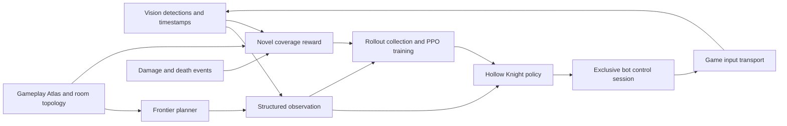

# Hollow Knight Bot research and implementation proposal

**🤖 B** runs the stencil-based menu routine, then hands gameplay to one learned actor for the active mode. Gameplay and Hacker have independent Stable-Baselines3 weights. Each actor chooses movement, aim, jump, and attack together using recent perception and a ground-based Atlas path. **K** records the controls and outcomes used to train it. Progress along the path, damage, dwelling, and confirmed enemy damage and kills affect the strength of demonstrated actions during training. The sections below preserve the original research and proposed milestones. [Current recording, training, and playback design](macos/BOT_DEMONSTRATIONS.md)

Hollow Knight Bot should learn to expand Vision's Gameplay Atlas using detected terrain and enemies, while avoiding damage and prolonged lack of progress. Reuse **Stable-Baselines3 PPO**, establish a small policy with recent observation history, and compare **SB3-Contrib RecurrentPPO** when memory becomes useful. Keep an Atlas frontier planner responsible for selecting destinations and the learned policy responsible for movement, jumping, and attacking.

Published permissive platformer checkpoints exist, but the candidates below consume Mario images and use Mario actions. None is a verified direct replacement for a policy consuming Vision's lines and enemy positions. The most promising time savings are the training implementation, demonstrations, repeatable game resets, and a small observation space. Direct transfer of Mario weights should be an optional experiment after a Hollow Knight baseline works.

## Reusable projects and models

| Candidate | What is available | License evidence | Fit for Hollow Knight Vision |
| --- | --- | --- | --- |
| [Stable-Baselines3](https://github.com/DLR-RM/stable-baselines3) and [SB3-Contrib](https://github.com/Stable-Baselines-Team/stable-baselines3-contrib) | Training libraries, including PPO and recurrent PPO; these are algorithms rather than pretrained platformer policies. | Explicit MIT licenses for [SB3](https://github.com/DLR-RM/stable-baselines3/blob/master/LICENSE) and [Contrib](https://github.com/Stable-Baselines-Team/stable-baselines3-contrib/blob/master/LICENSE). | **Recommended foundation.** Recurrent PPO supports vector or dictionary observations and simultaneous MultiDiscrete actions. Start with ordinary PPO to simplify timing, debugging, and deployment. |
| [akantox Mario PPO](https://huggingface.co/akantox/mario-rl-model) | Model card links 25M and 50M step checkpoints. Its stated input is four grayscale frames at 250 by 264, with seven actions. | Model repository metadata declares MIT. | A candidate for a transfer benchmark, with limited environment and evaluation detail. Replacing the image input and action outputs requires substantial retraining. Checkpoint files and claimed behavior have not been executed or validated here. |
| [FluidInference MarioStudent Core ML](https://huggingface.co/FluidInference/mario-student-coreml) | Published PyTorch and Core ML policy artifacts; two RGB crops feed eleven movement macros. Trained with imitation and DAgger. | Model repository metadata declares Apache-2.0. | Useful native inference and imitation reference. The publisher reports 53 of 96 flag captures for the model alone; the stronger 78 of 96 result also uses emulator lookahead. Hollow Knight has neither the same dynamics nor that forward simulator. |
| [OpenAI Procgen](https://github.com/openai/procgen) | Procedural environments including CoinRun, Jumper, Ninja, and Climber; a simulator and training benchmark, rather than a supplied universal controller. | [MIT code](https://github.com/openai/procgen/blob/master/LICENSE); graphics have [separate asset licenses](https://github.com/openai/procgen/blob/master/ASSET_LICENSES.md). | Useful for fast platforming experiments. The published interface is visual; a structured observation adapter would be required. Packaging and Python support also need checking on the target Mac. It does not provide Hollow Knight physics or combat. |
| [CleanRL](https://github.com/vwxyzjn/cleanrl) | Compact PPO and other RL implementations, including Procgen examples. | [MIT with additional component notices](https://github.com/vwxyzjn/cleanrl/blob/master/LICENSE), including Apache-2.0 attribution for portions of the Procgen examples. | Good implementation reference and benchmarking alternative. SB3 is the simpler initial integration for a custom environment. |
| [HollowRL](https://github.com/Abdul-AzizOM/HollowRL), [HollowKnightRLenv](https://github.com/OrangeScript/HollowKnightRLenv), and [DQN_HollowKnight](https://github.com/ailec0623/DQN_HollowKnight) | Existing Hollow Knight boss-fighting experiments. HollowRL describes a structured state feed and multiple action heads; HollowKnightRLenv describes recurrent PPO and frame stepping. | The reviewed root listings do not provide an explicit reusable license. | Architectural references only until the relevant source and weights have explicit permissive terms. Boss combat and privileged game state also differ from exploration through Vision's detections. |
| [myouo hk_Rl](https://github.com/myouo/hk_Rl) | Structured game-state environment, recurrent policies, training and evaluation infrastructure for boss tasks. | Its [license file](https://github.com/myouo/hk_Rl/blob/main/LICENSE) includes MIT text followed by a research and personal modding only note. | Treat the additional wording as a licensing ambiguity to resolve before reuse. This is also a game-state agent, so its policy interface would require adaptation to Vision. |

The transfer assessment is an engineering inference from the published observation and action interfaces. An image encoder trained on Mario does not automatically interpret geometric line arrays. Changing the first layers and action heads may leave little useful transferable behavior, especially with different jump physics, attack timing, camera behavior, and exploration objectives.

Source licenses, weight licenses, and simulator asset licenses should be recorded separately for anything actually imported. Pin the selected revision, retain the applicable notices in `THIRD_PARTY_LICENSES`, and update [THIRD_PARTY_NOTICES.md](THIRD_PARTY_NOTICES.md). No external code, model, ROM, or gameplay data is imported by this proposal.

## Architecture

The frontier planner chooses a reachable boundary between mapped and unexplored space, including routes through known rooms. This gives the local policy a destination and allows purposeful backtracking. An LSTM can remember a recent jump or enemy motion; room topology and the Atlas should hold long-term exploration memory.

Keep the existing detector and the new bot policy as separate versioned models. Initially freeze the detector while training the bot so changes in perception do not silently alter the environment between updates.

### Policy observations

Use coordinates relative to the Knight, normalized by a fixed reference scale. Express positions and velocities in one documented coordinate system. Detector boxes currently use a top-left normalized origin, while captured ground geometry uses bottom-left solve pixels. Convert them once at the observation boundary.

| Observation | Proposed contents | Handling uncertainty |
| --- | --- | --- |
| Knight | Detected box, estimated velocity, facing estimate, support beneath feet, previous controls. | Include confidence, age, and validity. Subtract measured camera motion when estimating world motion. |
| Terrain | Nearest 16 confirmed line segments, endpoints relative to the Knight, confidence, and presence mask. | Use stable ordering and bounded distance. A missing line means unknown terrain; it does not establish a pit. |
| Enemies | Nearest 8 enemy detections, relative box, estimated velocity, confidence, age, and presence mask. | Use the object catalog's enemy group, including user-created classes. Track identities across time before estimating velocity. |
| Destination | Relative frontier position, route direction, distance, and progress toward it. | Reject destinations on unplaced or contradictory map geometry. |
| Context | Recent observation history, time since progress, known movement abilities, and validity flags. | Clear history at scene discontinuities, resets, and model changes. Unknown abilities remain unavailable. |

These limits are starting configuration values to measure against real captures. Mask padded entries so zero coordinates cannot be mistaken for real platforms or enemies. Feedforward PPO can start with four recent observations; compare against recurrent PPO on the same evaluation tasks. The [Contrib documentation](https://sb3-contrib.readthedocs.io/en/master/modules/ppo_recurrent.html) requires carrying recurrent state and resetting it through the episode-start signal.

Ground lines and enemy boxes support an initial walking and jumping curriculum. Robust play will also need walls, ceilings, moving platforms, and dangerous surfaces such as spikes or acid. The bot must retain an unknown-terrain state until those semantics exist.

Health is needed for rewards even if it is excluded from the initial policy input. If health or soul later enters the policy, both game modes need a measured visual representation with explicit missingness.

### Policy actions and timing

Start with `MultiDiscrete([3, 3, 2, 2])`:

- Horizontal: neutral, left, right.
- Aim: neutral, up, down.
- Jump: released or held.
- Attack: released or held.

This permits moving, jumping, and attacking together while making opposite directions impossible. The receiver currently maps Z to jump and X to attack. Keep transport mappings outside the model contract and respect configured bindings in Normal mode. Add dash, cast, and healing after the initial movement tasks pass and their availability can be observed.

Begin with 10 to 15 decisions per second, holding the chosen state for a bounded duration. Consecutive jump holds control jump height; releases and attack press edges must survive transport. Log the actual simulation duration and committed input, rather than assuming a wall-clock sleep advanced a fixed number of frames.

Use a Python worker for early training and inference to keep the exact SB3 policy in the loop. After the feedforward baseline passes, export and compare native inference through Core ML on macOS and ONNX Runtime on Windows. SB3 documents [policy export patterns](https://stable-baselines3.readthedocs.io/en/master/guide/export.html), but preprocessing, action decoding, and recurrent state require explicit parity checks.

## Rewards and episode boundaries

The primary reward should measure **new confirmed Atlas coverage**. Frame count, observation count, allocated tile count, and the area of a bounding rectangle are unsuitable: revisiting the same location, allocating padding, or separating map fragments can increase those values without useful exploration.

Introduce a coverage ledger on a coarse grid, initially 32 by 32 solve pixels per cell. Count a cell only when accepted, committed visual evidence covers it. Exclude HUD, moving-object masks, unknown pixels, and rejected registrations. Associate cells with stable room geometry and reconcile them when islands merge or loop closures move the map. Provisional placement earns no immediate coverage reward; release credit only after it is confirmed and deduplicated.

Initialize the ledger from the selected Atlas. Checkpoint restores and episode restarts preserve the credited coverage for that training task, preventing repeated rewards for the starting view. A deliberate fresh-map experiment starts a new named ledger. Rebuilding an Atlas or changing its revision is not an exploration event.

Initial reward coefficients for tuning:

| Event | Starting reward | Definition |
| --- | --- | --- |
| New coverage | +0.02 per new cell, capped at +1 per simulated second | Each accepted cell can earn credit once per task ledger. |
| Damage | -2 per health unit lost | Prefer a monotonic damage-event counter; healing or changing max health must not cancel earlier damage. |
| Death | Additional -10 | One terminal event per life; the final damage event can also contribute its normal penalty. |
| Prolonged lack of progress | -0.05 per simulated second after 15 seconds | No new coverage and no meaningful progress along a valid frontier route. |

These coefficients are proposed starting values, not demonstrated training results. Log each component separately and tune the tradeoff against measured coverage and damage. A bounded route-progress term can be added if exploration remains too sparse; reset its baseline when the destination changes so repeated replanning cannot manufacture reward.

Measure stagnation over position history and route progress, not just distance between consecutive frames. Walking in circles or alternating left and right should still count as staying in the same area. Purposeful travel through a mapped corridor should remain possible. Freeze stagnation time while paused, loading, disconnected, or waiting for valid observations.

Damage needs additional instrumentation. `HUDStencilResult.health` contains matched icons, and its matching/hold behavior is not a validated health-loss sensor. `ReceiverGroundTruthSample` currently includes position and motion but no damage counter. For Modded training, add negotiated damage and death counters with sequence numbers. For Normal mode, validate a temporal full/empty health classifier against labeled clips; missed or flashing icons must not become fabricated damage.

Death ends an episode. Manual stop, capture failure, process loss, time budget, and stale observations truncate it. A normal room transition can continue the exploration episode once fresh observations arrive; it must clear motion history without applying a death penalty. PPO needs the distinction between termination and truncation for value targets, as described in [SB3's environment guidance](https://stable-baselines3.readthedocs.io/en/master/guide/rl_tips.html).

## Existing integration points and gaps

| Current code | Reuse | Required addition |
| --- | --- | --- |
| [LiveDashboardView.swift](macos/Sources/HollowKnightVision/LiveDashboardView.swift), `pathRecordingButton` | Placement and shortcut style of the K control. | Adjacent robot icon and B toggle, readiness explanation, active state, and stop behavior. |
| [LiveCaptureModel.swift](macos/Sources/HollowKnightVision/LiveCaptureModel.swift) | Capture lifecycle, object inference results, room state, atlas updates. | Timestamped bot observation publication, model lifecycle, start/stop orchestration, and reward event synchronization. |
| [LiveWorldGroundGeometry.swift](macos/Sources/HollowKnightVision/LiveWorldGroundGeometry.swift) and [LiveObjectDetector.swift](macos/Sources/HollowKnightVision/LiveObjectDetector.swift) | Confirmed owned ground lines and detected object boxes. | Capture-local observation adapter with consistent units, age limits, masks, and velocity history. |
| [LiveTiledAtlas.swift](macos/Sources/HollowKnightVision/LiveTiledAtlas.swift) and [LiveWorldModel.swift](macos/Sources/HollowKnightVision/LiveWorldModel.swift) | Accepted contributions, room ownership, tracking islands, and correction revisions. | Deduplicated coverage ledger tied to committed evidence and map corrections. |
| [GameControlForwarder.swift](macos/Sources/HollowKnightVision/GameControlForwarder.swift) and [NormalGameKeyForwarder.swift](macos/Sources/HollowKnightVision/NormalGameKeyForwarder.swift) | Receiver/native input, releases, focus handling, and session management. | Exclusive bot input ownership and a fresh-observation deadline. Existing physical-key reconciliation must not release bot-owned buttons. |
| [InputPathRecorder.swift](macos/Sources/HollowKnightVision/InputPathRecorder.swift) | Physical input events and time-correlated tracking evidence. | Demonstration export with aligned observations and committed actions. Existing paths alone are not complete training datasets. |
| [InputBridge.swift](macos/Sources/HollowKnightVision/InputBridge.swift) and [receiver source](macos/hollow-knight-input-receiver/src) | Input bitsets, 250 ms watchdog, capability negotiation, checkpoints, and control acknowledgements. | Training step capability, damage counters, and defined reset semantics. |
| [Windows MainWindow.xaml](windows/src/HollowKnightVision.Windows.App/MainWindow.xaml), [WindowsGameControlForwarder.cs](windows/src/HollowKnightVision.Windows.App/WindowsGameControlForwarder.cs), and [Windows Core](windows/src/HollowKnightVision.Windows.Core) | Corresponding dashboard, controls, world model, and detector. | The same observation/action contracts, coverage semantics, lifecycle, and native inference parity. |

**The current controlled-frame replay is not an RL environment step.** [Mod.ControlledFrames.cs](macos/hollow-knight-input-receiver/src/Mod.ControlledFrames.cs) calls `ApplyPlayerPose` from the replay request. Training must let movement emerge from physics and controls. Add a separate capability that advances a bounded number of simulation frames without pose injection and returns the matching rendered frame and committed action. Preserve the replay contract for its existing diagnostic purpose.

Checkpoint restoration also needs an audit for training. A player pose restore does not establish that enemies, health, hazards, scene state, camera motion, and random state have reset consistently. Use named task fixtures with an explicit reset procedure and readiness checks. Record what is deterministic and vary enemy timing during training when exact reset state is unavailable.

Policy inputs should remain visual in Modded mode. Use internal telemetry for reward validation, reset control, and evaluation; record it separately so ground-truth positions and velocities cannot leak into a policy expected to work from detections.

## Robot B control

Add **🤖 B** beside K in both the Gameplay and Hacker bottom bars. Use the robot emoji or a small vector robot icon and a visible B, matching K's sizing. Gameplay observations remain visual; Hacker always consumes exact-frame mod actors and human-authored green floors.

- B or a click starts the selected trained policy when capture, perception, model compatibility, and input transport are ready.
- B or a second click stops immediately, releases every bot-owned button, and closes the current rollout as truncated.
- Active operation has an obvious tint and an accessible label of “Stop Hollow Knight Bot.” The idle label is “Start Hollow Knight Bot.”
- Unavailable operation shows a specific reason, such as missing policy or stale Knight detection. An active stop control remains usable even after readiness is lost.
- Text entry, sheets, and key-repeat events must not accidentally start the bot. B stays a Vision command and is never forwarded to the game.
- Leaving Gameplay and Hacker, opening settings or labeling, losing focus, stopping capture, switching game mode or Atlas, or losing the game connection stops the bot. Manual gameplay input takes over after releasing bot controls.
- Recording, replay, checkpoint operations, and training updates cannot race with bot input. Initially make ordinary K recording and bot control mutually exclusive; bot rollouts use a separate recorder.

Keep **Play** and **Train** as explicit modes. B runs the installed checkpoint without updating it. Training is a separate operation with its own progress, checkpoint selection, and reset behavior. If no trained model exists, explain the training requirement rather than presenting random actions as a capable bot. A geometry controller can be offered as a clearly named development baseline.

Input renewal requires fresh observations. The existing receiver watchdog is useful, but continuing heartbeats with an old policy decision would keep unsafe stale controls alive. Add a capture-age deadline and generation token; stopping or changing mode invalidates all queued actions. If optimization pauses collection, release controls and acquire the existing game pause lease before waiting.

## Training strategy

1. **Measure the interface.** Capture aligned terrain, Knight/enemy detections, controls, coverage, and damage. Measure walking speed, jump arcs at different hold durations, attack timing, perception delay, and transport delay.
2. **Collect demonstrations.** Use K to save synchronized replay and learning recordings under one shared ID. Include travel in both directions, jumps of different heights, gaps, enemy avoidance, and attacks. Train the actor by behavior cloning before live PPO; this requires an explicit supervised stage in addition to SB3's ordinary PPO training.
3. **Train short tasks.** Begin with safe movement to a nearby destination, then platform transitions, gap crossing, enemy encounters, room exits, and frontier exploration. Use the same observation encoding in every stage.
4. **Fine-tune in the game.** Collect fresh rollouts from the current policy, compute the specified rewards, and apply PPO updates. Keep model versions, behavior log probabilities, value predictions, episode boundaries, and normalization statistics with each rollout. Do not repeatedly treat old K demonstrations as on-policy PPO experience.
5. **Evaluate checkpoints.** Run frozen policies from held-out starts with varied enemy timing. Compare ordinary PPO, recurrent PPO, behavior cloning, and the geometry baseline. Promote the checkpoint that improves coverage with acceptable damage, rather than the most recent training checkpoint.
6. **Deploy native inference.** Verify that Python, Core ML, and ONNX produce matching action scores and decoded controls on recorded observations. Recurrent export additionally needs state-carry and reset parity.

A lightweight geometric simulator could accelerate early jumping practice. Calibrate its dynamics from the game and randomize physics, terrain, detection noise, and latency. Procgen can help test generalization, but adapting its platforming interface and physics has a cost; benchmark that route against demonstrations plus direct training before investing in it.

At 15 decisions per second, one million decisions requires about **18.5 hours of game time**, before resets and optimization. That is arithmetic, not a convergence estimate. Faster simulation and parallel environments should be treated as measured follow-up work, not assumed capabilities of the current capture and replay code.

## Implementation milestones

| Milestone | Deliverables | Completion evidence |
| --- | --- | --- |
| 1. Observation and reward contracts | Shared schema, coordinate adapter, input history, coverage ledger, damage source, and rollout exporter. | Replay fixtures prove age rejection, coordinate alignment, deduplication through loop closure and resets, real damage accounting, and correct episode boundaries. |
| 2. Controllable baseline | Robot B UI, exclusive input session, bounded action holds, status display, and clearly identified geometry baseline. | Installed macOS app demonstrates movement, jumping, attack, manual takeover, and immediate release on every interruption path. |
| 3. Training environment | Physics-only step capability, synchronized render acknowledgements, audited task resets, Gymnasium adapter, and demonstration exporter. | A reproducible reset/step trace shows actions cause motion without replay pose injection; stale or disconnected steps truncate cleanly. |
| 4. First learned policy | Behavior cloning stage, SB3 PPO training, persisted models, model manifest, and frozen evaluation runner. | A held-out task report compares coverage, damage, deaths, stagnation, and completion against the baseline across multiple starts and training seeds. |
| 5. Exploration policy | Frontier routing, room traversal, recurrent comparison, and unknown/hazard handling. | Longer evaluation runs increase confirmed unique coverage and leave stale areas without repeated reward from loops, resets, or map corrections. |
| 6. Native deployment and Windows | Core ML/ONNX export, shared fixtures, Windows B control, and transport parity. | Matching policy outputs plus live tests of each installed app. Follow `macos/build-app.sh` and `windows/build-windows.ps1`; launch their installed copies as required by [AGENTS.md](AGENTS.md). |

Track confirmed new area per minute, damage per minute, area gained per damage unit, deaths, time without progress, task success, and action-to-observation latency. Use held-out rooms or starts and multiple training seeds; SB3's [evaluation guidance](https://stable-baselines3.readthedocs.io/en/master/guide/rl_tips.html) emphasizes separate evaluation and variability between runs.

The first implementation slice should be Milestone 1 plus the bot input lifecycle from Milestone 2. Those establish whether the observations and rewards are trustworthy before a long training run. Reusing SB3 then avoids implementing and debugging PPO itself.
