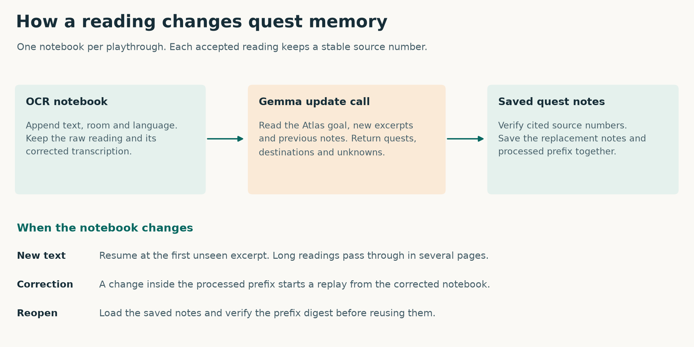
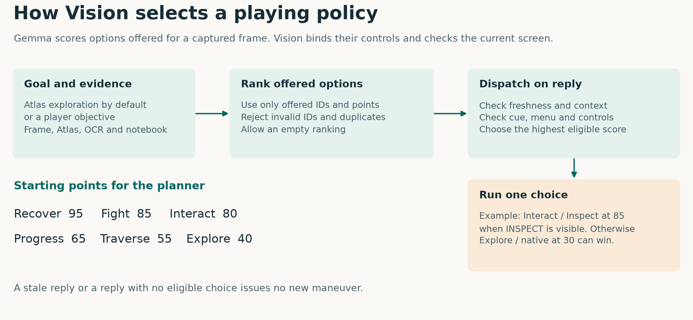

# Playing policy architecture

The macOS player has six policies. Exploring unmapped Atlas territory is the default objective. **Use Atlas goal** clears a previously saved goal. Gemma ranks the options Vision offers for the current screen. Shopping wishes are advisory.

## How Gemma uses the notebook

One loaded model can handle OCR proofreading, a quest update and a policy request. Vision constructs the message list separately for each call. Keeping the model resident saves loading time. To reuse a clue after a restart, Vision stores it and includes it in a later request. Editing an earlier token changes the context on which later attention states depend. An inference engine may reuse an identical prefix and recompute the affected suffix. [Ollama chat API](https://docs.ollama.com/api/chat) · [Causal attention and the KV cache](https://huggingface.co/docs/transformers/cache_explanation)



1. **Keep the source.** Each playthrough has a chronological notebook of accepted OCR readings. Each entry keeps its raw text, room, language and optional correction. R1 is its first row. The permanent objective is to complete the Atlas, including the progression needed to beat the game.
2. **Update the quest notes on new text.** The selected local model, Gemma by default, reads the permanent goal, a page of new evidence, and the previous notes. It returns a replacement JSON document containing `quests`, `destinations` and `unknowns`. A bare INSPECT or LISTEN prompt and rows classified as credits, HUD, menu or prompt stay in the notebook. A page containing only those rows advances the checkpoint without calling Gemma. Each note cites one to three rows. A new or revised note must cite fresh evidence. Vision drops a destination that simply repeats the source room’s name unless the cited reading also mentions it. The reader verifies those references and atomically saves the notes and processed prefix in `Notebooks/QuestMemory/<playthrough>.json`. A failed batch keeps the last valid checkpoint. A changed earlier transcription causes a replay from the corrected text.
3. **Ask for one decision.** The selector gets the Atlas objective and chronological evidence first, then the current quest notes, the pinned scene and the player’s goal. The available option IDs come last and appear in Ollama’s response schema. A remembered passage can justify revisiting a room. Vision uses current screen evidence to bind any interaction.


The notebook can outgrow an inference window. Gemma’s warm-up, notebook update and policy selection all request the same 4,096-token context. The output ceilings are 420 tokens for an update and 640 for a decision. The updater accounts for every accepted reading across bounded pages. The selector includes the whole log if it fits its 1,250-byte excerpt budget. For longer logs it ranks excerpts by overlap with the player’s goal, then by citation and recency, restores chronological order and reports the number included. Long readings are split at Unicode scalar boundaries. The notes may hold up to six leads, so the archive remains the source for omitted details. [Ollama context length](https://docs.ollama.com/context-length)

### Decision contract

| Field | Meaning |
| --- | --- |
| `choices[].option` | An ID Vision offered on the captured screen. Movement options include `traverse` and `explore`. Interactions include `readPrompt` when INSPECT or LISTEN is visible. |
| `choices[].points` | Integer priority from 1 to 100. Consider immediate danger, the player's objective, supported quest leads and reachable unmapped ground. |
| `shopping`, optional `shop` | Wishes with desire, spending ceiling and reserve. The current decoder stores these fields. The affordability helper has no production caller. |

Gemma can rank up to six distinct choices or return an empty array. On arrival Swift resolves the IDs against the original offer. In a ready Gameplay or Hacker workspace it automatically dispatches against the current save, goal, generation, room, receiver and fresh screen. A newer capture supersedes an older in-flight reply. Vision issues no new action on abstention, when every choice is ineligible, or when automatic policies are paused. The highest eligible score wins. Vision's movement policy decides movement and button timing from its live inputs. Thinking shows the exact response schema and the latest resolved policy. [Policy contract](../../macos/Sources/HollowKnightVision/ThinkingPolicyContract.swift) · [Runtime policy registry](../../macos/Sources/HollowKnightVision/BotSkillPlan.swift) · [Ollama structured outputs](https://docs.ollama.com/capabilities/structured-outputs)

### Policy audit

The six current registry entries are useful starting behaviors. Explore, Traverse and Progress share a route follower. Keep exploration and progression as persistent objectives and hand reachable targets to Traverse. Fight and Recover need observations that distinguish enemies, attack windows and available SOUL. Keep prompt and dialogue actions in Interact, expose Menu as a separate controller and introduce Buy only when an offer, funds and a verified purchase outcome are available.

The current request already prevents invented controls through a per-frame option list. It offers generic movement choices on every gameplay frame and requires shopping data even for empty movement replies. The proposed contract uses the fixed objective code `expandAtlas`, numeric entity handles and decision-local IDs such as `c0`. It binds target-specific candidates in Vision, lets Gemma score candidate IDs or abstain, and puts price and reserve exclusively on Buy. Slide 7 gives both schema widths. Slides 8–13 list each policy’s actual inputs and its largest gap. The final slides show proposed fields and outcome tests. [Proposed offer schema](proposed-offer.schema.json) · [Proposed reply schema](proposed-reply.schema.json)

In the proposal Vision initializes the objective to the constant `expandAtlas` and allocates candidate keys such as `c0` within each decision. Integer entity handles resolve through Vision’s registry for that decision. A traversal offer carries the measured route direction, normalized remaining distance and automatic-frontier flag already represented in `BotRoadHint`. Vision must have a route hint for the offered waypoint before emitting it. The example numbers illustrate the encoding. Gemma returns integer priorities keyed by the offered IDs. Game text and saved readings can still serve as observations alongside the offer.

### Passive observation and decision cadence

Proposed. Keep the Atlas objective and source-cited quest notes across requests. Sample a screenshot around every 30 seconds and on room changes. Skip image inference when the scene and OCR are unchanged. Validate newly observed NPCs against the active save and room, then merge a description, last-seen timestamp and evidence reference into that room’s journal. Check live state every five seconds. Request a new proposal on a material change and keep one request in flight. The persistent Atlas objective supplies the default when no player goal is set.

A future shop option could bind to a known menu and item ID. A future waypoint option could bind to a save-scoped Atlas room ID, room-local coordinates and a reachable route. Vision would offer only targets it can resolve and verify.

A local Gemma 3 4B check with a 4,096-token context used the recorded tablet evidence and two 640 × 360 frames. Cached text decisions took 3.55–3.73 s. Changing the visible cue took 10.54 s, with zero cached prompt tokens in that sample. Repeated-image decisions took 3.90–4.08 s. The two image evaluations without prompt-cache hits took 22.45–23.79 s. A separate short screenshot-only NPC probe took 12.99 s. Even five cached text decisions plus one new-image decision consumed an estimated 40–43 s of serial processing in a 30-second window. The five-second check can stay periodic while model requests follow changes. These timings cover model requests on a warm local runtime and use a small recorded sample.

### Recorded tablet replay

The archived replay below used the earlier contract. The current option-ranking replay on the same fixture returned `{"choices":[{"option":"readPrompt","points":95}],"shopping":[]}`. The controller resolved it to Interact / Inspect. With the player goal “Read the sign in front of the Knight,” the bare INSPECT reading stayed in the journal. The passage became R2. Gemma cited R2 in its notes about collecting SOUL and healing. The raw OCR contains “SOUIL” and “SOLIL,” and those spellings survived in the generated notes. Swift selected Inspect on the recorded prompt and rejected it when the cue was removed. [Captured input, notes and decision](gemma-tablet-replay.json)

```json
{"policy": "interact", "control": "inspect", "points": 90, "cue": "INSPECT"}
```



Under the current contract Vision offers `readPrompt` for the visible INSPECT cue. Gemma can rank it above an `explore` fallback. Vision tests both choices on the live screen when the reply arrives. If the room changed, it discards the reply. If only the prompt disappeared, a still-eligible Explore fallback may run. A maneuver can start from idle or take over the current motor lease temporarily. A normal completion resumes that motor.


Five policies project the four-frame observation into role-specific numeric inputs. Interact needs six flags for each proposed control. With no learned weights installed, each policy can already issue game controls. Reading a passage and mapping new cells have explicit outcome checks. Other maneuvers record their end reason and need task-specific evaluation to establish success.

## Latest matched-start result

On November 23 the Hacker Gymnasium comparison gave each candidate 512 training decisions from the round-69 learner, then evaluated all three actors on the same three King’s Pass seeds. Mean path progress was 92.40 for the champion, 85.58 for the 820-input candidate and 82.69 for the 337-input candidate. All nine episodes stalled in the starting room. The champion retained its place. This experiment measured the shared motor. It leaves the performance of the six specialists open.

Open the [six-policy guide](../../macos/BOT_SKILLS.md) for field groups, starter actions, training tasks, controls and the Gymnasium comparison procedure. The [PowerPoint deck](playing-policies.pptx) shows the context and handoff diagrams, the recorded reply, one input slide per policy, and the policy audit, the timed observer, and proposed target-bound executors. Regenerate the figures with `python draw_diagrams.py` and `python draw_quest_context.py` in an environment with Matplotlib.
