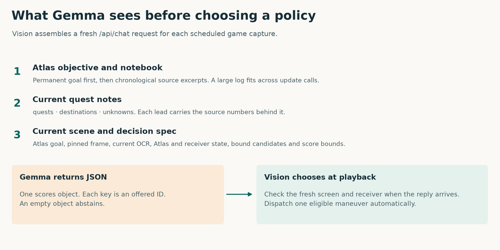
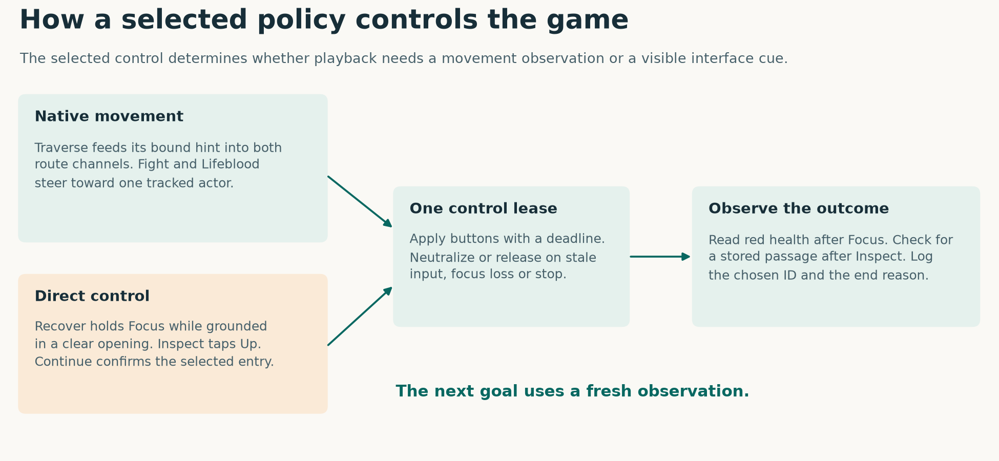

# Playing policy architecture

Explore and Progress choose reachable targets on the Atlas platform graph. Vision offers those targets to Gemma as Traverse candidates. The player dispatches the highest-scoring eligible candidate automatically in a ready macOS Gameplay or Hacker workspace. **T** opens Thinking and shows the captured offer, reply and dispatch result.

## How Gemma uses the notebook

One loaded model can handle OCR proofreading, a quest update and a policy request. Vision constructs the message list separately for each call. Keeping the model resident saves loading time. To reuse a clue after a restart, Vision stores it and includes it in a later request. Editing an earlier token changes the context on which later attention states depend. An inference engine may reuse an identical prefix and recompute the affected suffix. [Ollama chat API](https://docs.ollama.com/api/chat) · [Causal attention and the KV cache](https://huggingface.co/docs/transformers/cache_explanation)

1. **Keep the source.** Each playthrough has a chronological notebook of accepted OCR readings. Each entry keeps its raw text, room, language and optional correction. R1 is its first row. The permanent objective is to complete the Atlas, including the progression needed to beat the game.
2. **Update the quest notes on new text.** The selected local model, Gemma by default, reads the permanent goal, a page of new evidence, and the previous notes. It returns a replacement JSON document containing `quests`, `destinations` and `unknowns`. A bare INSPECT or LISTEN prompt and rows classified as credits, HUD, menu or prompt stay in the notebook. A page containing only those rows advances the checkpoint without calling Gemma. Each note cites one to three rows. A new or revised note must cite fresh evidence. Vision drops a destination that simply repeats the source room’s name unless the cited reading also mentions it. The reader verifies those references and atomically saves the notes and processed prefix in `Notebooks/QuestMemory/<playthrough>.json`. A failed batch keeps the last valid checkpoint. A changed earlier transcription causes a replay from the corrected text.
3. **Ask for one decision.** The selector gets the Atlas objective and chronological evidence first, then the current quest notes, the pinned scene and the fixed Atlas objective. The available option IDs come last and appear in Ollama’s response schema. A remembered passage can justify revisiting a room. Vision uses current screen evidence to bind any interaction.

The notebook can outgrow an inference window. Gemma’s warm-up, notebook update and policy selection all request the same 4,096-token context. The output ceilings are 420 tokens for an update and 640 for a decision. The updater accounts for every accepted reading across bounded pages. The selector includes the whole log if it fits its 1,250-byte excerpt budget. For longer logs it ranks excerpts by overlap with the Atlas objective, then by citation and recency, restores chronological order and reports the number included. Long readings are split at Unicode scalar boundaries. The notes may hold up to six leads, so the archive remains the source for omitted details. [Ollama context length](https://docs.ollama.com/context-length)

### Decision contract and policy inputs

The offer contains a version (2), a decision ID, the fixed objective `expandAtlas` and up to 12 candidate IDs. The [offer schema](proposed-offer.schema.json) defines the vocabulary. Swift generates a closed response schema from the IDs it offered. An example reply is `{"scores":{"c0":92,"c1":40}}`. An empty scores object abstains. Every score must be an integer from 1 through 100. Earlier candidates win ties. See the [two-candidate reply schema](proposed-reply.schema.json).

| Role | Evidence used to make an offer | What the controller does |
| --- | --- | --- |
| Explore → Traverse | Reachable unvisited ground in registered Atlas coverage. The pathfinder selects a frontier and the next graph waypoint. | Offer a Traverse candidate with `road_frontier: true`. |
| Progress → Traverse | The reachable path to the selected Atlas objective, including the graph's default upper-right objective. Quest notes can influence ranking. | Offer a second Traverse candidate with its own waypoint and `road_frontier: false` when available. |
| Traverse | Room, route, waypoint, normalized direction, remaining distance and frontier flag. | Resolve the handle to its chart, goal and waypoint. Feed the fresh selected hint to both road input groups before evaluating the movement actor or starter. |
| Fight | Nearest observed enemy with a stable receiver instance ID and a relative position. | Follow that actor and pulse attack within reach. |
| Recover | Focus reads current main-vessel SOUL, red health, max red health, the game's Focus permission, ground contact and nearby enemies. Lifeblood uses the nearest observed cocoon. | Offer Focus with at least 33 SOUL, missing red health and a clear grounded opening. Hold A for up to 1.55 s and release on a gained mask, lost opening or expired evidence. Lifeblood approaches and strikes the bound cocoon. |
| Interact / Menu | Exact INSPECT or LISTEN cue, or Continue selected in the pause menu. | Inspect and Talk press Up and watch the notebook. Menu confirms the selected entry. |
| Buy and other verbs | The schema reserves Buy, Bench, Advance Dialogue, Activate and Collect. | The selector withholds them until it can bind the required state. |

Integer handles are local to the captured offer. An enemy ID in the offer indexes a binding to the real Unity instance. Route identity includes the goal, waypoint and chart. Gemma receives the numeric route values and an opaque handle. A response belongs to its original request. Capture generation, room, workspace, mode, profile, freshness and target eligibility are checked again before control. A newer pending capture supersedes an older request. If a native target disappears during execution, playback releases its controls.

The selector and the movement actor have different inputs. The five legacy schema-16 numeric projections have widths **133 / 284 / 134 / 143 / 163** for Explore / Traverse / Fight / Recover / Progress. Traverse's 284 values are **149 current + 3 × 45 earlier**. Focus uses the six live conditions above independently of those historical columns. Missing receiver telemetry prevents a Focus offer and keeps older recordings and motor checkpoints readable. Automatic dispatch runs in modded mode. Both the Gameplay and Hacker workspaces use an exact matched receiver frame for route, actor and SOUL offers. Prompt and menu candidates use their own screen evidence.

### Passive observation and decision cadence

Proposed. Keep the Atlas objective and source-cited quest notes across requests. Sample a screenshot around every 30 seconds and on room changes. Skip image inference when the scene and OCR are unchanged. Validate newly observed NPCs against the active save and room, then merge a description, last-seen timestamp and evidence reference into that room’s journal. Check live state every five seconds. Request a new proposal on a material change and keep one request in flight. The persistent Atlas objective supplies the default when no player goal is set.

A local Gemma 3 4B check with a 4,096-token context used the recorded tablet evidence and two 640 × 360 frames. Cached text decisions took 3.55–3.73 s. Changing the visible cue took 10.54 s, with zero cached prompt tokens in that sample. Repeated-image decisions took 3.90–4.08 s. The two image evaluations without prompt-cache hits took 22.45–23.79 s. A separate short screenshot-only NPC probe took 12.99 s. Even five cached text decisions plus one new-image decision consumed an estimated 40–43 s of serial processing in a 30-second window. The five-second check can stay periodic while model requests follow changes. These timings cover model requests on a warm local runtime and use a small recorded sample.

### In-game verification

The [handoff trace](handoff-v2.json) records the exact offers, scores, applied button masks, horizontal position, red health and main-vessel SOUL from a save-disabled King’s Pass episode. The test exercises both target selectors and Recover through the production resolver and playback controller. The isolated episode starts one mask down with 66 SOUL and uses a measured local objective on an authored floor. The deterministic cases choose each offered target deliberately so a change in model preference cannot skip a controller.

| King’s Pass check | Observed result |
| --- | --- |
| Explore → Traverse | Right input moved the Knight from x 34.50 to 36.15. |
| Progress → Traverse | Left input moved the Knight from x 36.16 to 35.34 toward a different waypoint on the same floor. |
| Recover → Focus | Four red masks became five. Main-vessel SOUL fell from 66 to 33. |
| Local Gemma → Traverse | With both routes offered, Gemma 3 4B scored c0 at 85 and c1 at 30. The controller moved right from x 35.33 to 36.15. |

The [v2 tablet replay](gemma-v2-tablet.json) records Gemma scoring the recorded Inspect offer at 95. In a separate save-disabled game, a fresh screenshot produced an Inspect score of 85. Vision pressed Up and the notebook reopened with the new passage. The [archived tablet replay](gemma-tablet-replay.json) preserves the earlier wire format and its actual OCR. Its stored passage, cited as R2 in the quest notes, describes Focus healing. The private tablet test checks that the passage can be retrieved after reopening the notebook.

## Latest matched-start result

On November 23 the Hacker Gymnasium comparison gave each candidate 512 training decisions from the round-69 learner, then evaluated all three actors on the same three King’s Pass seeds. Mean path progress was 92.40 for the champion, 85.58 for the 820-input candidate and 82.69 for the 337-input candidate. All nine episodes stalled in the starting room. The champion retained its place. This experiment measured the shared motor. It leaves the performance of the six specialists open.

The [playing policy guide](../../macos/BOT_SKILLS.md) covers controls, starter inputs and the comparison procedure. The [PowerPoint deck](playing-policies.pptx) covers the offer, selectors, controller inputs and in-game results. Regenerate the figures with `python draw_diagrams.py` and `python draw_quest_context.py` in an environment with Matplotlib.
